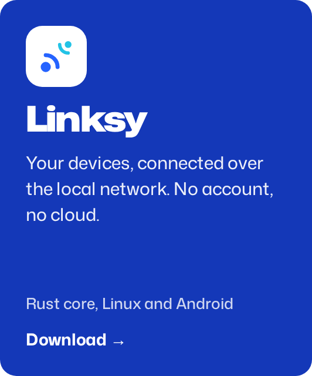
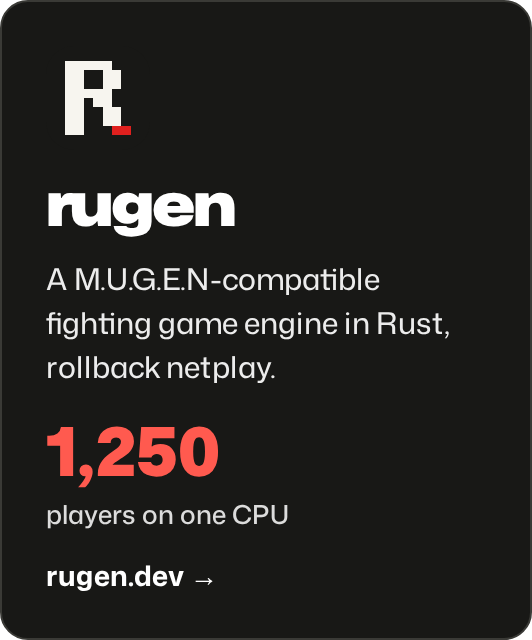

**Developer in Antananarivo.** I build products end to end: the Flutter app, the SvelteKit site, the Rust engine underneath, and the servers they run on.

[**diary.mg**](https://diary.mg) &nbsp;·&nbsp; [Book a 30-min call](https://calendly.com/axeldiaryrakotoarivao/30min) &nbsp;·&nbsp; [Mobile apps](https://diary.mg/en/mobile) &nbsp;·&nbsp; [LinkedIn](https://www.linkedin.com/in/diary-axel-rakotoarivao-356532268/) &nbsp;·&nbsp; [Email](mailto:axeldiaryrakotoarivao@gmail.com)

## Now shipping

## Also live

 &nbsp;**Ohayo Prepa**, pass the BAC with 20 minutes a day. [ohayoprepa.mg](https://ohayoprepa.mg)

 &nbsp;**HogLens**, PostHog on your phone, with a home-screen widget. [Download](https://github.com/Diary-Axel-RAKOTOARIVAO/hoglens-releases/releases/latest)

 &nbsp;**1% Daily**, one money goal, 1% closer every day. [Download](https://github.com/1-percent-daily/public-app-release/releases/latest)

 &nbsp;**Tantana**, HR, payroll and accounting for Malagasy SMEs. [tantana.ohayoprepa.mg](https://tantana.ohayoprepa.mg)

 &nbsp;**Vivace** and **Screenshift**, the CSS and SCSS libraries diary.mg runs on. [usevivace.dev](https://usevivace.dev) &nbsp;·&nbsp; [Screenshift on npm](https://www.npmjs.com/package/screenshift)

## Built with

         
