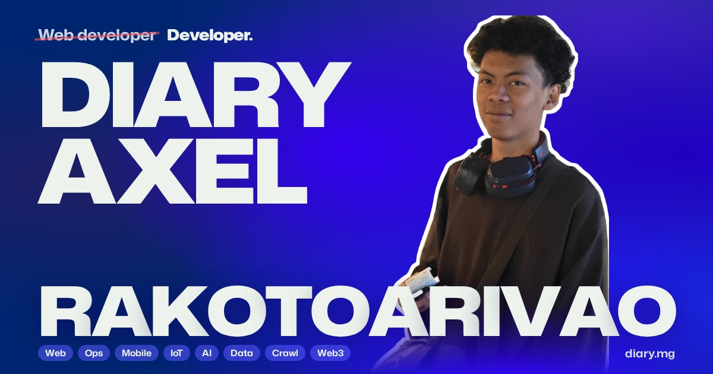

**Developer in Antananarivo, Madagascar.** I build products end to end: the Flutter app, the SvelteKit or Astro site, the Rust engine underneath when it needs one, and the servers they run on. Most of what's below is live and used every day.

[**diary.mg**](https://diary.mg) &nbsp;·&nbsp; [Mobile apps](https://diary.mg/en/mobile) &nbsp;·&nbsp; [Book a 30-min call](https://calendly.com/axeldiaryrakotoarivao/30min) &nbsp;·&nbsp; [LinkedIn](https://www.linkedin.com/in/diary-axel-rakotoarivao-356532268/) &nbsp;·&nbsp; [axeldiaryrakotoarivao@gmail.com](mailto:axeldiaryrakotoarivao@gmail.com)

## What I'm building

| Project | What it is | Where |
|---|---|---|
| **MadaRent** | Find a rental in Madagascar: verified listings by neighbourhood, map, alerts. Web and Android on one API, about 15,000 visitors a month. | [madarent.mg](https://madarent.mg) · [Android](https://madarent.mg/application) |
| **rugen** | A M.U.G.E.N-compatible 2D fighting game engine in Rust, with rollback netplay and a self-hosted hub that holds about 1,250 players on one CPU. | [rugen.dev](https://rugen.dev) · [code](https://github.com/rugen-dev/rugen-engine) |
| **Ohayo Prepa** | Pass the BAC and entrance exams with 20 minutes a day: timed mock exams, auto-correction, AI-predicted subjects. | [ohayoprepa.mg](https://ohayoprepa.mg) |
| **GENO Smart** | Flutter app for the GENORING X3 health ring, built for Genopuzzle: sleep, HRV, blood oxygen and a voice AI coach, over a pure Dart Bluetooth protocol. | [Google Play](https://play.google.com/store/apps/details?id=smart.genoring.app) |
| **Linksy** | Your devices, connected over the local network with no account and no cloud. Rust core (QUIC, mDNS) shared by the Linux and Android apps. | [releases](https://github.com/LinkSy-mg/linksy-releases/releases/latest) |
| **HogLens** | All your PostHog projects on your phone, with an Android home-screen widget. | [releases](https://github.com/Diary-Axel-RAKOTOARIVAO/hoglens-releases/releases/latest) |
| **1% Daily** | One money goal, 3 priorities a day, 3 results a week. Data stays on the phone. | [releases](https://github.com/1-percent-daily/public-app-release/releases/latest) |
| **Tantana** | HR, payroll and accounting for Malagasy SMEs, with IRSA, CNaPS and OSTIE built in. | [tantana.ohayoprepa.mg](https://tantana.ohayoprepa.mg) |
| **Vivace** | CSS animations driven by HTML attributes. 18 keys, 5 triggers, zero dependencies. | [usevivace.dev](https://usevivace.dev) · [code](https://github.com/Diary-Axel-RAKOTOARIVAO/vivace) |
| **Screenshift** | Responsive containers and a debug overlay in one SCSS attribute. | [npm](https://www.npmjs.com/package/screenshift) · [code](https://github.com/Dokja620/screenshift) |

## What I build with

            

Deployed with Dokploy behind Cloudflare Tunnel and Zero Trust.
